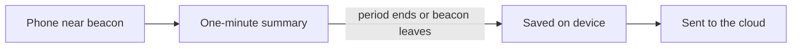

# SelectBeaconSDK

An iOS 17+ Swift Package that ranges the Select iBeacon fleet with Core Location.

## How detection and reporting work

When a phone is near a Select beacon, the SDK does **not** send a separate
network report for every radio ping. Instead it groups activity into short
observation periods and sends a compact summary afterward.



**In plain terms:**

1. **Listen.** The app listens for Select beacons while it is allowed to use
   location (permission is owned by the host app, not this SDK).
2. **Summarize each minute.** For about 60 seconds per beacon, the SDK keeps a
   running summary: how many times it was seen, the strongest signal, the most
   recent approximate location it already has on hand, and the last time it was
   heard.
3. **Save a report when the period ends.** That happens when the minute is up,
   or sooner if the beacon has not been heard for about 30 seconds (the person
   likely walked away). The report is written to the phone first so it is not
   lost if the network is down.
4. **Send in batches when it is a good time.** Queued reports upload together
   when no Select beacon has been heard for about a minute (foreground), when
   the oldest saved report is about five minutes old (so a busy venue cannot
   stall forever), when the app moves to background or returns to the
   foreground, or when connectivity comes back. Short background “wake”
   moments save reports only and do not open a network upload. If the phone is
   offline, reports stay on the device (no send attempt). If a send is tried
   and the API is unreachable, the SDK keeps the reports and retries with
   exponential backoff: 15 seconds, then 30, 60, … up to five minutes, resetting
   after a successful acknowledgement. Turning detection off finishes any open
   summary so that minute is not discarded.

Location is approximate and battery-conscious (“which area / store,” not
continuous high-accuracy GPS). Nearby presence for the Select app UI is
separate from “a report is ready to upload.”

Technical design detail for engineers is in the
[architecture guide](docs/architecture.md).

## Integration

Add the package to the host app, then configure it during the host's startup flow:

```swift
import SelectBeaconSDK

SelectBeaconSDK.configure(
    appKey: distributorAppKey
)

SelectBeaconSDK.shared.onOperationalStatusChanged = { status in
    // Configuration, permission, ranging, or recoverable SDK state.
}

SelectBeaconSDK.shared.start()
```

Call `SelectBeaconSDK.shared.stop()` when distributor-level detection should end.
It stops ranging, finalizes open observation windows into the durable queue,
and clears active presence. Operational
`ready`, `awaitingPermission`, `paused`, `ranging`, and recoverable
`degraded` states are available through `operationalStatus` and
`onOperationalStatusChanged`.

## Select app integration

The standard `SelectBeaconSDK` product intentionally does not expose beacon
identities, RSSI, or pending report records. The Select-owned application can
add the separate `SelectBeaconAppSupport` product:

```swift
import SelectBeaconAppSupport

SelectBeaconAppSupport.shared.onActiveBeaconsChanged = { beacons in
    // Beacons observed within the SDK's 30-second absence timeout.
}

SelectBeaconAppSupport.shared.onOpenWindowsChanged = { windows in
    // In-progress 60-second summaries (not yet queued).
}

SelectBeaconAppSupport.shared.onPendingReportsChanged = { reports in
    // Durable FIFO awaiting upload acknowledgement (empties after successful ack).
}

SelectBeaconAppSupport.shared.onStopFinalizePendingChanged = { pending in
    // Gate Start until false. Empty open windows after stop are not enough.
}

let activeBeacons = SelectBeaconAppSupport.shared.currentBeacons
let openWindows = SelectBeaconAppSupport.shared.currentOpenWindows
let stopFinalizePending = SelectBeaconAppSupport.shared.isStopFinalizePending
let pendingReports = try await SelectBeaconAppSupport.shared.pendingReports()
```

`currentBeacons` is presence; `currentOpenWindows` is the in-progress minute
summary; `pendingReports()` is the durable queue. Pending items remain until
upload acknowledgement (offline/API failures keep them queued).
`isStopFinalizePending` is true while a `stop()`-initiated finalize enqueue is
still writing; do not treat an empty open-window snapshot as enqueue completion.
To empty the durable queue without deleting the app, stop detection, wait until
`isStopFinalizePending == false`, then call
`try await SelectBeaconAppSupport.shared.clearPendingReports()`.
For a full Select/debug UI brief, see
[`Examples/BeaconTest/CONSUMER_UI_PROMPT.md`](Examples/BeaconTest/CONSUMER_UI_PROMPT.md).
The adapter is a Select integration boundary, not a security boundary.

## API environments

Ingest and auth are implemented by the Select backend service
[beacon-ingestor](https://github.com/SelectDesign/beacon-ingestor). This SDK
posts to that service’s JSON:API endpoints on the configured environment host.

Production is the default and requires no additional consumer configuration:

```swift
SelectBeaconSDK.configure(appKey: key)
```

The production endpoint is internally stubbed as `REPLACE_ME_PRODUCTION` until the
backend contract is supplied. For staging, pass an explicit endpoint so separate
staging deployments can coexist:

```swift
SelectBeaconSDK.configure(
    appKey: stagingKey,
    environment: .staging(baseURL: stagingURL)
)
```

Replace the production placeholder with the confirmed endpoint before a
production upload transport is added. Configuration cannot change after `start()`;
stop and use a fresh process/session before switching environments.

When a usable environment base URL is configured, each ingest body is a
JSON:API document posted to `{base}/ingest/sdk/v1`:

```json
{
  "data": [
    {
      "type": "sdk_beacon",
      "attributes": {
        "uuid": "76F87C5C-AB0C-45C5-8E9A-19DEF7DC2911",
        "major": 1,
        "minor": 42,
        "best-rssi-dbm": -55,
        "observations": 4,
        "lat": 40.7128,
        "lng": -74.006,
        "first-seen": "2023-11-14T22:12:50Z",
        "last-seen": "2023-11-14T22:13:20Z",
        "device-id": "<identifierForVendor>"
      }
    }
  ]
}
```

`uuid` is the iBeacon proximity UUID. `device-id` is the vendor device ID (IDFV).
`first-seen` / `last-seen` are the observation window start and latest sighting.
`lat`/`lng` may be `null` when no location fix was available. Auth uses the same
host at `/ingest/auth/v1` with kebab-case `app-key`, and ingest sends
`Authorization: Bearer {token}`. HTTP 200 clears the entire uploaded batch from
the durable queue.

## Host-owned permissions

The SDK never requests location authorization. The host app must provide its own
`NSLocationWhenInUseUsageDescription` and, if background detection is required,
the appropriate Always authorization usage description and location background mode.

- `authorizedAlways`: ranging may continue in the background.
- `authorizedWhenInUse`: ranging runs only while the app is active.
- `notDetermined`, denied, or restricted: the SDK remains quiet.

## Testing

Run package tests with an iOS Simulator destination. Beacon ranging itself must be
validated on physical iPhone and iPad hardware; the Simulator cannot detect iBeacons.

For production gates, Xcode setup, simulator and device validation, version
tagging, and rollback guidance, follow [the release runbook](docs/releasing.md).

## Documentation

- [Architecture guide](docs/architecture.md)
- [Engineering constraints](docs/development-context.md)
- [Key decisions](docs/decisions.md)
- [Release runbook](docs/releasing.md)
- [Beacon ingestor (backend API)](https://github.com/SelectDesign/beacon-ingestor)
