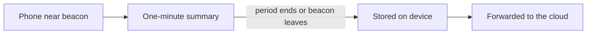

# SelectBeaconSDK

An iOS 17+ Swift Package that detects the Select iBeacon fleet with Core
Location (region monitoring + ranging).

## How detection and reporting work

When a phone is near a Select beacon, the SDK does **not** send a separate
network report for every radio ping. Instead it groups activity into short
observation periods and uses **store-and-forward**: save each closed period to
a durable on-device queue first, then drain that queue to the API in batches
when the earliest good opportunity arrives. Capture never depends on a
successful upload.



**In plain terms:**

1. **Listen.** The app listens for Select beacons while it is allowed to use
   location (permission is owned by the host app, not this SDK). Under Always
   authorization, region monitoring can wake a suspended app when the host has
   enabled location background mode; ranging then captures major/minor/RSSI.
2. **Summarize each minute.** For about 60 seconds per beacon, the SDK keeps a
   running summary: how many times it was seen, the strongest signal, the most
   recent approximate location it already has on hand, and the last time it was
   heard.
3. **Store a report when the period ends.** That happens when the minute is up,
   or sooner if the beacon has not been heard for about 30 seconds (the person
   likely walked away). The report is written to the phone first so it is not
   lost if the network is down.
4. **Forward in batches when it is a good time.** Queued reports upload together
   when no Select beacon has been heard for about a minute (foreground), when
   the oldest saved report is about five minutes old (so a busy venue cannot
   stall forever), when the app moves to background or returns to the
   foreground, when connectivity comes back, on `start()` if a prior-session
   backlog exists, or after enqueue when online. Background region wakes attempt
   only a **single batch** so the wake stays short; anything left remains on
   disk until a later full drain. If the phone is
   offline, reports stay on the device (no send attempt). If a send is tried
   and the API is unreachable, the SDK keeps the reports and retries with
   exponential backoff: 15 seconds, then 30, 60, … up to five minutes, resetting
   after a successful acknowledgement. Turning detection off finishes any open
   summary so that minute is not discarded.

Location is approximate and battery-conscious (“which area / store,” not
continuous high-accuracy GPS). Nearby presence for the Select app UI is
separate from “a report is ready to upload.”

Technical design detail for engineers — including the named store-and-forward
pattern and trigger rationale — is in the
[architecture guide](docs/architecture.md) (§5b).

## Integration

Checklist for standard hosts:
[docs/host-integration.md](docs/host-integration.md).

### Install

SPM URL: `https://github.com/SelectDesign/select-beacon-sdk.git`. Pin a published
version (do not track a floating branch). Current release: **1.0.0** (`v1.0.0`).

```swift
.package(url: "https://github.com/SelectDesign/select-beacon-sdk.git", from: "1.0.0")
```

Depend on product `SelectBeaconSDK`. The Select-owned app also depends on
`SelectBeaconAppSupport`.

Add the package to the host app, then configure it during the host's startup flow:

```swift
import SelectBeaconSDK

SelectBeaconSDK.configure(
    appKey: distributorAppKey,
    appSecret: distributorAppSecret
)

SelectBeaconSDK.shared.onOperationalStatusChanged = { status in
    // Configuration, permission, ranging, auth, or other recoverable SDK state.
    // Handle `.degraded(.authenticationFailed)` for token-broker failures.
}

SelectBeaconSDK.shared.start()
```

Call `SelectBeaconSDK.shared.stop()` when distributor-level detection should end.
It stops region monitoring and ranging, finalizes open observation windows into
the durable queue, and clears active presence. Operational
`ready`, `awaitingPermission`, `paused`, `ranging`, and recoverable
`degraded` states are available through `operationalStatus` and
`onOperationalStatusChanged`.

**Authentication failures:** when the token broker rejects the client (HTTP
401/403), returns an unusable token body, or the auth endpoint is invalid, status
becomes `.degraded(.authenticationFailed)`. Detection may continue and Queued
reports stay on disk; upload keeps retrying with normal backoff. The degrade
clears on the next successful token mint (same appKey/secret is enough after a
temporary API suspension) or on a successful `configure`. Transient network /
5xx / 429 auth failures do **not** change `operationalStatus` (optional
diagnostics only).

### Optional diagnostics

Use `operationalStatus` for in-app UX (including `.authenticationFailed`).
Optionally install a diagnostics reporter to forward coarse events (queue
failures, upload failures, dead-letter, eviction, missing device id) to the
host’s own monitoring:

```swift
final class HostDiagnosticsReporter: SelectBeaconDiagnosticsReporting {
    func record(_ event: SelectBeaconDiagnosticEvent, error: Error) {
        // Forward `event` only — do not log tokens, secrets, or full payloads.
        monitoring.capture(String(describing: event))
    }
}

SelectBeaconSDK.shared.setDiagnosticsReporter(HostDiagnosticsReporter())
// Pass nil later to clear the sink.
```

The SDK does not ship a monitoring client. Do not log secrets, tokens, request
bodies, or beacon identities from the optional `error` parameter.

## Select app integration

Checklist for the Select-owned app:
[docs/select-app-integration.md](docs/select-app-integration.md).

The standard `SelectBeaconSDK` product intentionally does not expose beacon
identities, RSSI, or pending report records. The Select-owned application can
add the separate `SelectBeaconAppSupport` product:

```swift
import SelectBeaconAppSupport

SelectBeaconAppSupport.shared.onActiveBeaconsChanged = { beacons in
    // Beacons observed within the SDK's 30-second absence timeout.
}

SelectBeaconAppSupport.shared.onOpenWindowsChanged = { windows in
    // In-progress 60-second summaries (not yet queued).
}

SelectBeaconAppSupport.shared.onPendingReportsChanged = { reports in
    // Durable FIFO awaiting upload acknowledgement (empties after successful ack).
}

SelectBeaconAppSupport.shared.onDeadLetteredReportsChanged = { reports in
    // Non-retryable / max-attempt failures (not re-uploaded).
}

SelectBeaconAppSupport.shared.onStopFinalizePendingChanged = { pending in
    // Gate Start until false. Empty open windows after stop are not enough.
}

let activeBeacons = SelectBeaconAppSupport.shared.currentBeacons
let openWindows = SelectBeaconAppSupport.shared.currentOpenWindows
let stopFinalizePending = SelectBeaconAppSupport.shared.isStopFinalizePending
let pendingReports = try await SelectBeaconAppSupport.shared.pendingReports()
let deadLetters = try await SelectBeaconAppSupport.shared.deadLetteredReports()
```

`LocationFix` on open windows and pending/dead-letter reports is for Select /
AppSupport UI (cached coarse location). Standard hosts should ignore it and stay
on `operationalStatus` only.

`currentBeacons` is presence; `currentOpenWindows` is the in-progress minute
summary; `pendingReports()` is the durable queue. Pending items remain until
upload acknowledgement (offline/API failures keep them queued).
`isStopFinalizePending` is true while a `stop()`-initiated finalize enqueue is
still writing; do not treat an empty open-window snapshot as enqueue completion.
To empty the durable queue without deleting the app, stop detection, wait until
`isStopFinalizePending == false`, then call
`try await SelectBeaconAppSupport.shared.clearPendingReports()`.
To empty dead letters only, call
`try await SelectBeaconAppSupport.shared.clearDeadLetteredReports()` under the
same gates (pending is left alone).
For a full Select/debug UI brief, see
[`Examples/BeaconTest/CONSUMER_UI_PROMPT.md`](Examples/BeaconTest/CONSUMER_UI_PROMPT.md).
The adapter is a Select integration boundary, not a security boundary.

## API environments

Ingest and auth are implemented by the Select backend service
[beacon-ingestor](https://github.com/SelectDesign/beacon-ingestor). This SDK
posts to that service’s HTTP ingest endpoints on the configured environment host.

Production is the default and requires no additional consumer configuration:

```swift
SelectBeaconSDK.configure(appKey: key, appSecret: secret)
```

The production endpoint is
`https://ingestor.beacons.selectbrandhub.com`. For staging, pass an explicit
**HTTPS** endpoint so separate staging deployments can coexist (cleartext
`http` is rejected):

```swift
SelectBeaconSDK.configure(
    appKey: stagingKey,
    appSecret: stagingSecret,
    environment: .staging(baseURL: stagingURL)
)
```

Staging and production use the live token-broker and HTTP ingest implementations
when a usable HTTPS base URL is configured. Auth is `POST {base}/auth/v1` with
`app_key` / `app_secret`; ingest sends `Authorization: Bearer {access_token}`.
Configuration cannot change after `start()`; stop and use a fresh process/session
before switching environments.

When a usable environment base URL is configured, each ingest body is posted to
`{base}/sdk/v1/detections`:

```json
{
  "detections": [
    {
      "uuid": "76F87C5C-AB0C-45C5-8E9A-19DEF7DC2911",
      "major": 1,
      "minor": 42,
      "best_rssi_dbm": -55,
      "observations": 4,
      "lat": 40.7128,
      "lng": -74.006,
      "first_seen": "2023-11-14T22:12:50Z",
      "last_seen": "2023-11-14T22:13:20Z",
      "device_id": "<identifierForVendor>",
      "idempotency_key": "<durable-queue-record-id>"
    }
  ]
}
```

`uuid` is the iBeacon proximity UUID. `device_id` is the vendor device ID (IDFV).
`first_seen` / `last_seen` are the observation window start and latest sighting.
`lat`/`lng` may be `null` when no location fix was available. Auth uses the same
host at `/auth/v1` with snake_case `app_key` and `app_secret`, and ingest sends
`Authorization: Bearer {token}` from the broker response. HTTP 200 clears the entire
uploaded batch from the durable queue.

## Host-owned permissions

The SDK never requests location authorization. The host app must provide its own
`NSLocationWhenInUseUsageDescription` and, if background detection is required,
the appropriate Always authorization usage description and location background
mode (`UIBackgroundModes` / capability). Real beacon wakes depend on that host
configuration; the SDK only implements Core Location region monitoring + ranging.
The package includes `PrivacyInfo.xcprivacy` declaring Device ID and Precise
Location for App Functionality (no tracking); that does not replace host
Info.plist usage strings.

- `authorizedAlways`: region monitoring stays active when backgrounded; ranging
  runs in short bursts on region enter/inside (not continuous suspended ranging).
- `authorizedWhenInUse`: detection runs only while the app is active.
- `notDetermined`, denied, or restricted: the SDK remains quiet.

### Background and screen-off

Whether detection continues after the user leaves the app (or turns the screen
off) depends on authorization **and** host background configuration.

**When In Use:** detection stops when the app is no longer active (background or
inactive). With the screen off and the app not active, this SDK session does not
monitor or range. Detection resumes when the app becomes active again if
`start()` intent is still on.

**Always** (intended path for background / screen-off wakes) requires **both**:

1. The user grants **Always** location authorization (host prompts; SDK never
   requests permission).
2. The host enables **Background Modes → Location updates**
   (`UIBackgroundModes` includes `location`). Always alone is not enough for
   reliable wakes of a suspended app.

Then:

| Situation                                  | Behavior                                                                                                                                                                                                                                   |
| ------------------------------------------ | ------------------------------------------------------------------------------------------------------------------------------------------------------------------------------------------------------------------------------------------ |
| Foreground, screen on                      | Region monitoring and continuous ranging                                                                                                                                                                                                   |
| App backgrounded / inactive                | Engine stays started; continuous ranging stops; region monitoring continues                                                                                                                                                                |
| Region enter / “inside” while backgrounded | Short ranging burst for major/minor/RSSI, then observation windows and durable enqueue                                                                                                                                                     |
| Screen off / device locked                 | Same wake/burst model — **not** continuous ranging. iOS may still deliver region enter/exit; display-on can refresh region state. Durable enqueue uses Class C Data Protection so writes can succeed after first unlock while locked later |
| Upload while backgrounded                  | At most one batch per wake; remaining queue stays on disk                                                                                                                                                                                  |

This is **region-monitor wake → brief range → store-and-forward**, not continuous
beacon scanning with the screen off (battery and Core Location policy).

**Host checklist for background / screen-off wakes:**

1. Info.plist When-In-Use and Always usage strings (as required for Always).
2. Enable Background Modes → Location updates.
3. Obtain Always authorization in the host before relying on wakes.
4. `configure` then `start()`; leave start intent on (do not `stop()` merely
   because the app backgrounded).
5. Validate on physical devices — the Simulator cannot prove iBeacon region wakes.

## Testing

Run package tests with an iOS Simulator destination. Beacon region monitoring and
ranging must be validated on physical iPhone and iPad hardware; the Simulator
cannot detect iBeacons.

For production gates, Xcode setup, simulator and device validation, version
tagging, and rollback guidance, follow [the release runbook](docs/releasing.md).

## Documentation

- [Architecture guide](docs/architecture.md)
- [Engineering constraints](docs/development-context.md)
- [Key decisions](docs/decisions.md)
- [Release runbook](docs/releasing.md)
- [BeaconTest harness](Examples/BeaconTest/README.md)
- [Beacon ingestor (backend API)](https://github.com/SelectDesign/beacon-ingestor)

## License

This package is proprietary software owned by Select. See [LICENSE](LICENSE).
Use and integration require a separate written agreement with Select.
