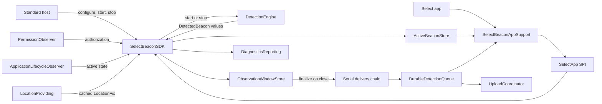

# SelectBeaconSDK Architecture Guide

This document is for engineers maintaining the SDK. It describes the current
implementation, its deliberate boundaries, and where future work belongs.

## Purpose

`SelectBeaconSDK` is an iOS 17+ Swift Package embedded by VIP's BizStride app.
It detects Select iBeacons, aggregates sightings into observation-window
reports, persists those reports, and separates standard SDK lifecycle control
from Select-app data views.

It uses Core Location only. Do not add raw CoreBluetooth scanning: BizStride
already uses Footmarks, and Core Location avoids Bluetooth-radio contention and
an additional Bluetooth permission flow.

## Public API

The public surface is intentionally small:

```swift
SelectBeaconSDK.configure(
    appKey: "...",
    environment: .production // default
)

SelectBeaconSDK.shared.onOperationalStatusChanged = { status in
    // Non-sensitive configuration, permission, and ranging state.
}

SelectBeaconSDK.shared.start()
SelectBeaconSDK.shared.stop()
```

- `configure` stores a valid app key and environment only. It does not range,
  request permission, create the durable queue, or perform network I/O.
- `start` is quiet until a valid app key has been configured.
- `stop` stops ranging, finalizes open observation windows into the durable
  queue, and clears active presence. The next `start` begins a fresh window
  session.
- `SDKOperationalStatus` communicates configuration, permission, ranging, and
  recoverable persistence issues without beacon or queue data.
- Standard consumers do not receive beacon identities, RSSI, report IDs, or
  durable queue contents.
- `SelectBeaconAppSupport` is a separate package product for the Select app.
  It receives data through a `@_spi(SelectApp)` bridge, which organizes API
  access but is not a security boundary.

The main SDK type is `@MainActor`; host interactions, state changes, and
detection handling execute on the main actor.

## Runtime flow



### 1. Enablement and environment

`Configuration/Configuration.swift` contains internal configuration types:

- `AppIdentity` validates a non-empty app key.
- `SelectBeaconSDK.Environment` selects production or staging.
- Production uses the internal `REPLACE_ME_PRODUCTION` placeholder until a real
  endpoint is supplied.
- Staging requires a caller-supplied HTTP or HTTPS URL, allowing multiple
  staging deployments.
- `SDKEnablementConfiguration` combines the app key and endpoint information.

Configuration is locked after the first `start()` call. This prevents one
process from mixing environments in the same detection session.

### 2. Permission and lifecycle coordination

`PermissionObserver.swift` maps Core Location authorization into the SDK's
`LocationAuthorization` enum:

- `always`: ranging may continue when the app is backgrounded.
- `whenInUse`: ranging occurs only while the app is active.
- `notDetermined` and `unavailable`: the SDK stays quiet.

The SDK **never** calls `requestWhenInUseAuthorization()` or
`requestAlwaysAuthorization()`. The host owns the permission experience.

`ApplicationLifecycleObserver.swift` observes app active/inactive transitions.
It is used solely to enforce foreground-only ranging under When In Use
authorization.

`RangingSessionState.swift` is pure state-machine logic. It combines:

- configured/not configured
- host start/stop intent
- current authorization
- application activity
- current ranging state

and produces either `startRanging`, `stopRanging`, or `none`. Keep policy
decisions here so they can be unit tested without an app or location hardware.

### 3. Beacon ranging

`CoreLocationDetectionEngine.swift` is a main-actor Core Location adapter. It creates
`CLBeaconIdentityConstraint` values and starts/stops ranging through
`CLLocationManager`.

`LocationManaging` is a small wrapper protocol around the Core Location calls.
It exists so engine tests can inject a fake manager and verify constraints
without physical beacons.

The shipped configuration ranges one fleet UUID:

`76F87C5C-AB0C-45C5-8E9A-19DEF7DC2911`

The internal engine accepts an array to avoid an engine redesign if Select
adds fleets later. Do not expose multi-UUID configuration publicly unless that
product decision is revisited.

The engine maps `CLBeacon` to `DetectedBeacon`:

- UUID: Select fleet identity
- Major: program identifier
- Minor: individual unit identifier
- RSSI: received signal strength

RSSI `0` is Core Location's unknown-value sentinel and is ignored.

### Select app state views

`SelectBeaconAppSupport` exposes the stateful views needed by the Select
application:

- `currentBeacons` and `onActiveBeaconsChanged` are derived from
  `ActiveBeaconStore`, keyed by `(UUID, major, minor)`. Every valid observation
  refreshes the stored RSSI and timestamp. A beacon expires after the shared
  30-second absence timeout; stopping ranging clears the active snapshot.
- `currentOpenWindows` and `onOpenWindowsChanged` expose in-progress
  observation-window aggregates. `stop()` publishes an empty open-window
  snapshot synchronously, before durable enqueue finishes.
- `pendingReports()` and `onPendingReportsChanged` read the complete FIFO
  durable queue. They include records written during a prior app launch.
- `isStopFinalizePending` and `onStopFinalizePendingChanged` track whether a
  `stop()`-initiated finalize enqueue is still in flight. Hosts must gate Start
  on this flag becoming `false`; empty open windows alone are not sufficient.

These views are intentionally separate. An in-window sighting updates active
presence and window aggregates without appending a pending report until the
window closes. Sparse background ranging wakes are expected to enqueue more
often than they upload.

### 4. Observation windows

`ObservationWindowStore.swift` is pure, in-memory aggregation logic. It
receives `now` as an argument; it must never read the system clock directly.

Beacon identity is `(UUID, major, minor)`. Each identity owns at most one open
window:

1. The first sighting opens a 60-second window and initializes aggregates.
2. Further sightings inside the window update `bestRSSI` (max),
   `latestTimestamp`, most recent non-nil `LocationFix`, and
   `observationCount`.
3. A sighting after the window duration closes the old window and opens a new
   one at the current sighting.
4. A 30-second absence without sightings closes the window even with no further
   observations.

Finalized reports are **durably enqueued immediately** on close. Send debounce
only controls when the upload coordinator attempts network delivery.

`SelectBeaconSDK.stop()` finalizes open windows so an in-progress minute is not
lost, then clears active presence. Permission and ordinary foreground/background
changes do not reset open windows by themselves. Only `stop()` advances
`deliverySession`; `start()` intentionally does not, so an immediate restart
cannot drop the stop-finalize enqueue. While that enqueue runs,
`isStopFinalizePending` remains `true` even if open windows are already empty.

### 4b. Cached location

`LocationProviding` / `CoreLocationProvider` maintain a low-power location
cache. Coarse standard updates run only while ranging; optional significant-
change monitoring keeps an idle baseline when Always authorization is available.
Detection logic reads `currentLocation` synchronously and never requests a
one-shot GPS fix per sighting. Unavailable authorization clears the cache to
`nil`; transient Core Location errors retain the last good fix. Location is not
part of the standard public API; Select pending reports may include it.

### 5. Durable queue

`DurableDetectionQueue.swift` contains the upload queue foundation:

- `QueuedDetection`: Codable persisted representation of a reportable beacon.
- `DurableDetectionQueue`: enqueue, batch retrieval, acknowledgement, and clear
  contract. Its operations are asynchronous so callers do not run file I/O on
  the main actor.
- `FileDetectionQueue`: actor-isolated, JSON file-backed implementation with
  atomic writes.
- `FileStoring`: file I/O seam for error and relaunch tests.

A reportable detection is appended to a serial delivery chain before it reaches
the queue actor. This preserves ranging-batch order across durable writes.
Queue file I/O does not run on the main actor; persistence failures are
recorded through `DiagnosticsReporting` and exposed as non-sensitive
operational status.

Stopping the SDK invalidates deliveries for its current session. Already-started
persistence can finish so the observation is not lost, but the Select adapter
will not receive a stale queue-change event from the stopped session.
Stop-finalize pending clears when that stop generation settles (success,
failure, or cancellation after `Task.cancel`), independent of ordinary
ranging/absence enqueues. A later empty `stop()` does not clear pending early
while a cancelled finalize write may still be in flight; the cancelled task's
completion hook clears the flag when that generation finishes.

Unreadable queue data is never replaced by a newly observed detection. Ordinary
enqueue / load paths return `DurableDetectionQueueError.unreadableStoredDetections`
so the original bytes remain for diagnosis. Hosts can intentionally recover with
AppSupport `clearPendingReports()` (SPI: `selectClearPendingReports()`), which
overwrites the durable file with an empty queue after detection is stopped and
stop-finalize has settled.

Queue files are isolated using a SHA-256 identifier derived from the app key
and resolved endpoint. The app key is not written to the file name. This keeps
production and each staging endpoint from sharing records after relaunch.

`QueuedDetection` stores window aggregates (`bestRSSI`, `latestTimestamp`,
`windowStartedAt`, `observationCount`, optional `location`). Legacy queue files
that still use `rssi` / `detectedAt` decode through compatibility keys.

### 6. Upload coordinator

`UploadCoordinator.swift` transmits already-persisted reports. Transmission
triggers (earliest wins, all connectivity-gated):

1. **Quiet debounce (foreground only):** no valid beacon sighting for
   `sendDebounce` (60s). Any sighting resets the timer. This is not reset by
   enqueue alone.
2. **Max queue age:** oldest record’s `queuedAt` older than `maxQueueAge`
   (300s) forces a send even if activity never goes quiet.
3. **App backgrounding** and **app foregrounding:** opportunistic immediate flush.
4. **Connectivity return:** immediate flush when the path becomes satisfied.

Offline triggers do not attempt a send and do not start retry backoff.
Failed sends retain the queue and retry with exponential backoff:

- Initial delay: `uploadRetryBackoff` = **15 seconds**
- After each failed attempt: delay **doubles**
- Cap: `uploadRetryBackoffMax` = **300 seconds**
- On successful acknowledgement: delay **resets** to 15 seconds
- Skipping a flush because the device is offline does **not** start this timer;
  connectivity return (or another later trigger) attempts again
- Records stay durable until acknowledged; the Select pending-report UI still
  shows them as queued (no separate “retrying” status yet)

One `AuthProvider.validToken()` call is made per batch. Sparse region-entry
ranging wakes enqueue only; they never invoke flush from `handle(_:)`.
Successful acknowledgement notifies `onSelectPendingReportsChanged` with the
remaining FIFO snapshot.

`UploadInterfaces.swift` defines the upload seams:

- `AuthProvider` supplies a currently valid bearer token.
- `UploadTransport` uploads a batch with that authorization.
- `UploadResponse` models a successful acknowledgement.

`BeaconUploadPayload.swift` defines the confirmed ingestion body as a JSON:API
v1 document: `{ "data": [ { "type": "sdk_beacon", "attributes": { … } } ] }`
with kebab-case attribute keys `uuid`, `major`, `minor`, `best-rssi-dbm`,
`observations`, `lat`, `lng`, `first-seen`, `last-seen`, and `device-id`
(`UIDevice.identifierForVendor`). `first-seen` maps from `windowStartedAt` and
`last-seen` from `latestTimestamp`. Client resource `id` is omitted. Missing
location encodes `lat`/`lng` as JSON `null`. The durable queue `id` is not
included in the body; on HTTP **200** the transport acknowledges the entire
posted batch using those local IDs. Eddystone `instanceId` is out of scope
(Core Location iBeacon only). `deviceId` is resolved at upload time; if IDFV is
unavailable the flush is skipped, recorded as `deviceIdentifierUnavailable`,
and retried with backoff.

Auth and ingest share the configured environment host:

- Token broker: `POST {base}/ingest/auth/v1` with kebab-case `app-key`;
  response `access-token` / `expires-in`
- Ingest: `POST {base}/ingest/sdk/v1` with
  `Authorization: Bearer {token}` and
  `Content-Type` / `Accept`: `application/vnd.api+json`

`TokenBrokerAuthProvider.swift` provides the SDK-owned authentication
implementation. It posts the configured app key to Select's token endpoint on
the same host as ingest, retains the returned access token and expiry in memory
only, and reuses that token until it is within its refresh safety margin.
Concurrent refreshes share one in-flight request. The SDK never holds or
transmits an Auth0 client secret, and the durable detection queue never stores
access tokens.

`HTTPIngestUploadTransport` performs the live ingest POST when the environment
base URL is a usable http(s) URL. Production remains deferred while
`REPLACE_ME_PRODUCTION` is still the placeholder. Tests use fakes against the
coordinator and HTTP seams.

## Diagnostics and Sentry

`DiagnosticsReporter.swift` provides the internal `DiagnosticsReporting` seam.
The SDK currently reports durable queue persistence failures—including queue
load and write failures—through it, plus upload failures and unavailable
`deviceId` (IDFV) when a flush cannot build the confirmed payload.
`durableQueueUnreadable` identifies corrupted persisted data separately from
`durableQueueWriteFailed`.

The core package must not import Sentry, because it has zero third-party
dependencies. The host app, or an optional adapter package, should bridge
sanitized SDK diagnostic events to Sentry.

Do not emit secrets, tokens, request headers, full payloads, or raw beacon
history in diagnostics. Rate-limit repeated failures such as offline retries.

## Tests

The tests are split by responsibility:

- `Tests/SelectBeaconSDKTests/Detection/SelectBeaconSDKLifecycleTests.swift`
  covers SDK behavior with fake engine, permission, lifecycle, queue, clock,
  and diagnostics dependencies.
- `Tests/SelectBeaconSDKTests/Detection/` also contains pure ranging-state,
  observation-window, location-provider, and Core Location constraint tests.
- `Tests/SelectBeaconSDKTests/Persistence/FileDetectionQueueTests.swift`
  covers relaunch, acknowledgement, persistence errors, malformed queue data,
  legacy JSON migration, and environment isolation.
- `Tests/SelectBeaconSDKTests/Networking/TokenBrokerAuthProviderTests.swift`
  covers cached token retrieval and refresh behavior without real networking.
- `Tests/SelectBeaconSDKTests/Networking/UploadCoordinatorTests.swift`
  covers debounce reset, batch auth, offline backoff, and opportunistic flush.
- `Tests/SelectBeaconSDKTests/Support/` holds shared in-memory file storage.

Run:

```bash
DEVELOPER_DIR=/Applications/Xcode.app/Contents/Developer \
xcodebuild test -scheme SelectBeaconSDK \
-destination 'platform=iOS Simulator,id=<simulator-udid>'
```

The Simulator cannot range beacons. Use
[`Examples/BeaconTest/README.md`](../Examples/BeaconTest/README.md) for the
physical iPhone/iPad validation checklist.

## File map

| File                                                     | Responsibility                                               |
| -------------------------------------------------------- | ------------------------------------------------------------ |
| `Public/SelectBeaconSDK.swift`                           | Core lifecycle, status, SPI bridge, and queue wiring         |
| `Public/SDKOperationalStatus.swift`                      | Standard-consumer operational status models                  |
| `Public/DetectedBeacon.swift`                            | Select-app SPI detection model                               |
| `Public/BeaconReporting.swift`                           | Select-app SPI observation and report models                 |
| `../SelectBeaconAppSupport/SelectBeaconAppSupport.swift` | Select app state-view adapter                                |
| `Configuration/Configuration.swift`                      | Internal app key, endpoint, environment, and queue namespace |
| `Detection/PermissionObserver.swift`                     | Observe-only Core Location authorization adapter             |
| `Detection/ApplicationLifecycleObserver.swift`           | App activity observer for When In Use policy                 |
| `Detection/RangingSessionState.swift`                    | Pure ranging policy state machine                            |
| `Detection/CoreLocationDetectionEngine.swift`            | Main-actor Core Location beacon ranging adapter              |
| `Detection/ObservationWindowStore.swift`                 | Pure 60s observation-window aggregation                      |
| `Detection/ActiveBeaconStore.swift`                      | In-memory active beacon snapshot                             |
| `Detection/LocationFix.swift`                            | SDK-owned cached location snapshot                           |
| `Detection/LocationProviding.swift`                      | Location cache protocol                                      |
| `Detection/CoreLocationProvider.swift`                   | Hybrid coarse / significant-change location                  |
| `Persistence/DurableDetectionQueue.swift`                | Actor-isolated persisted detection queue                     |
| `Networking/UploadInterfaces.swift`                      | Auth/transport upload contracts                              |
| `Networking/BeaconUploadPayload.swift`                   | JSON:API `sdk_beacon` document + kebab-case encoder          |
| `Networking/DeviceIdentifying.swift`                     | IDFV (`device-id`) seam for upload stamping                  |
| `Networking/HTTPIngestUploadTransport.swift`             | Live ingest POST with Bearer auth                            |
| `Networking/UploadCoordinator.swift`                     | Quiet debounce, max-age, and opportunistic batch upload      |
| `Networking/TokenBrokerAuthProvider.swift`               | In-memory Select token-broker authorization                  |
| `Support/Clock.swift`                                    | Injectable time source                                       |
| `Support/PresenceExpiryScheduler.swift`                  | Main-actor active-presence expiry seam                       |
| `Support/DiagnosticsReporter.swift`                      | Internal diagnostics bridge                                  |
| `Support/SDKDependencies.swift`                          | Internal live/test dependency composition                    |
| `development-context.md`                                 | Authoritative product constraints                            |
| `decisions.md`                                           | Short record of key decisions                                |
| `README.md`                                              | Host integration instructions                                |

## Maintenance rules

- Do not add raw CoreBluetooth scanning.
- Do not request Core Location authorization from the SDK.
- Do not range, upload, or perform permission checks during configuration.
- Do not expose Apple framework types through the public API.
- Do not resolve beacon serials on-device; the backend resolves Major/Minor.
- Do not add third-party dependencies to the core package.
- Do not read real time inside testable business logic.
- Do not add an endpoint, payload, or Auth0 client secret to the SDK. Auth uses
  Select's token broker with the configured app key only (`/ingest/auth/v1` on
  the environment host).
- Do not invent alternate ingest paths; use `/ingest/sdk/v1` with JSON:API
  `sdk_beacon` resources and kebab-case attributes.
