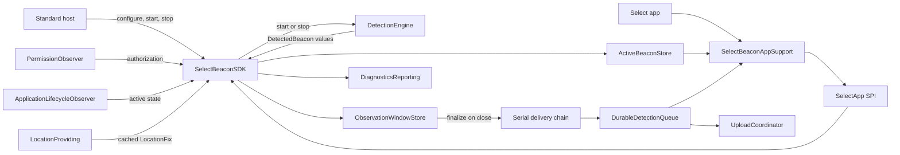

# SelectBeaconSDK Architecture Guide

This document is for engineers maintaining the SDK. It describes the current
implementation, its deliberate boundaries, and where future work belongs.

## Purpose

`SelectBeaconSDK` is an iOS 17+ Swift Package embedded by VIP's BizStride app.
It detects Select iBeacons, aggregates sightings into observation-window
reports, persists those reports, and separates standard SDK lifecycle control
from Select-app data views.

It uses Core Location only. Do not add raw CoreBluetooth scanning: BizStride
already uses Footmarks, and Core Location avoids Bluetooth-radio contention and
an additional Bluetooth permission flow.

## Public API

The public surface is intentionally small:

```swift
SelectBeaconSDK.configure(
    appKey: "...",
    appSecret: "...",
    environment: .production // default
)

SelectBeaconSDK.shared.onOperationalStatusChanged = { status in
    // Non-sensitive configuration, permission, and ranging state.
}

SelectBeaconSDK.shared.start()
SelectBeaconSDK.shared.stop()
```

- `configure` stores a valid `AppIdentity` (app key + app secret) and
  environment in memory only. It does not monitor, range, request permission,
  create the durable queue, or perform network I/O.
- `start` is quiet until a valid app key and app secret have been configured.
- `stop` stops region monitoring and ranging, finalizes open observation
  windows into the durable queue, and clears active presence. The next `start`
  begins a fresh window session.
- `SDKOperationalStatus` communicates configuration, permission, ranging, and
  recoverable persistence issues without beacon or queue data.
- Standard consumers do not receive beacon identities, RSSI, report IDs, or
  durable queue contents.
- `SelectBeaconAppSupport` is a separate package product for the Select app.
  It receives data through a `@_spi(SelectApp)` bridge, which organizes API
  access but is not a security boundary.

The main SDK type is `@MainActor`; host interactions, state changes, and
detection handling execute on the main actor.

## Runtime flow



### 1. Enablement and environment

`Configuration/Configuration.swift` contains internal configuration types:

- `AppIdentity` validates a non-empty app key and app secret.
- `SelectBeaconSDK.Environment` selects production or staging.
- Production uses the internal `REPLACE_ME_PRODUCTION` placeholder until a real
  endpoint is supplied.
- Staging requires a caller-supplied **HTTPS** URL (cleartext `http` is
  rejected), allowing multiple staging deployments.
- `SDKEnablementConfiguration` combines the app identity and endpoint information.

Configuration is locked after the first `start()` call. This prevents one
process from mixing environments in the same detection session.

### 2. Permission and lifecycle coordination

Two `CLLocationManager` instances are intentional:

1. **Detection engine** — region monitoring, ranging, and host authorization
   observation (same manager/delegate; auth is process-wide).
2. **Location provider** — coarse / significant-change cache for window stamps.

A third permission-only manager is not used. The SDK never requests permission.

`PermissionObserver` (implemented by `CoreLocationDetectionEngine`) maps Core
Location authorization into the SDK's `LocationAuthorization` enum:

- `always`: the engine stays started when backgrounded. Region monitoring can
  wake the process (host location background mode required); ranging runs in
  short bursts on enter/inside rather than continuous background ranging.
- `whenInUse`: monitoring/ranging run only while the app is active.
- `notDetermined` and `unavailable`: the SDK stays quiet.

The SDK **never** calls `requestWhenInUseAuthorization()` or
`requestAlwaysAuthorization()`. The host owns the permission experience.

`ApplicationLifecycleObserver.swift` observes app active/inactive transitions.
It enforces foreground-only detection under When In Use, and under Always it
tells the engine to drop continuous ranging while keeping region monitoring.

Screen off / device locked uses the same Always policy as backgrounding: the
engine stays started, continuous ranging is off, and region enter/inside
callbacks start short ranging bursts. Regions set
`notifyEntryStateOnDisplay = true` so iOS can refresh inside/outside when the
display turns on. This is not continuous suspended ranging. Host location
background mode is required for reliable wakes of a suspended process.

`RangingSessionState.swift` is pure state-machine logic. It combines:

- configured/not configured
- host start/stop intent
- current authorization
- application activity
- current ranging state

and produces either `startRanging`, `stopRanging`, or `none`. Keep policy
decisions here so they can be unit tested without an app or location hardware.

### 3. Beacon region monitoring and ranging

`CoreLocationDetectionEngine.swift` is a main-actor Core Location adapter. It:

- Starts **region monitoring** (`CLBeaconRegion` + `startMonitoring(for:)`) for
  each configured fleet UUID so iOS can wake a suspended app on enter/exit
  (Always authorization + host background-location capability required).
- Uses **ranging** (`CLBeaconIdentityConstraint` + `startRangingBeacons`) to
  read major/minor/RSSI. Foreground keeps continuous ranging for responsiveness;
  background drops continuous ranging and starts short ranging bursts on
  enter / determined-state inside, stopping on exit / outside. Screen-off and
  locked devices follow that same wake/burst path (not continuous ranging).
- Soft-caps monitored UUIDs (`maxMonitoredBeaconUUIDs`) so the SDK does not
  exhaust the app-wide 20-region budget shared with the host.

`LocationManaging` wraps Core Location calls so tests can inject a fake manager
and assert monitoring + ranging without physical beacons. Both monitoring and
ranging share one manager/delegate. No CoreBluetooth.

The shipped configuration monitors one fleet UUID:

`76F87C5C-AB0C-45C5-8E9A-19DEF7DC2911`

The internal engine accepts an array to avoid an engine redesign if Select
adds fleets later. Do not expose multi-UUID configuration publicly unless that
product decision is revisited.

The engine maps `CLBeacon` to `DetectedBeacon`:

- UUID: Select fleet identity
- Major: program identifier
- Minor: individual unit identifier
- RSSI: received signal strength

RSSI `0` is Core Location's unknown-value sentinel and is ignored.

### Select app state views

`SelectBeaconAppSupport` exposes the stateful views needed by the Select
application:

- `currentBeacons` and `onActiveBeaconsChanged` are derived from
  `ActiveBeaconStore`, keyed by `(UUID, major, minor)`. Snapshots are ordered
  by UUID, then major, then minor so list UIs stay stable when only RSSI or
  last-seen changes. Every valid observation refreshes the stored RSSI and
  timestamp. A beacon expires after the shared 30-second absence timeout;
  stopping ranging clears the active snapshot.
- `currentOpenWindows` and `onOpenWindowsChanged` expose in-progress
  observation-window aggregates. `stop()` publishes an empty open-window
  snapshot synchronously, before durable enqueue finishes.
- `pendingReports()` and `onPendingReportsChanged` read the complete FIFO
  durable queue. They include records written during a prior app launch.
- `deadLetteredReports()` and `onDeadLetteredReportsChanged` read the durable
  dead-letter store (non-retryable failure or max upload attempts). Same
  snapshot model as pending; separate list; not re-uploaded. Bounded by the
  same `maxQueueSize` / `maxRecordAge` as pending (oldest dropped; eviction
  emits `durableQueueEvicted`). `clearPendingReports()` clears pending only;
  `clearDeadLetteredReports()` clears dead letters only (same stop /
  stop-finalize gates).
- `isStopFinalizePending` and `onStopFinalizePendingChanged` track whether a
  `stop()`-initiated finalize enqueue is still in flight. Hosts must gate Start
  on this flag becoming `false`; empty open windows alone are not sufficient.

These views are intentionally separate. An in-window sighting updates active
presence and window aggregates without appending a pending report until the
window closes. Sparse background region wakes are expected to enqueue more often than they
fully drain the upload queue.

### 4. Observation windows

`ObservationWindowStore.swift` is pure, in-memory aggregation logic. It
receives `now` as an argument; it must never read the system clock directly.

Beacon identity is `(UUID, major, minor)`. Each identity owns at most one open
window:

1. The first sighting opens a 60-second window and initializes aggregates.
2. Further sightings inside the window update `bestRSSI` (max),
   `latestTimestamp`, most recent non-nil `LocationFix`, and
   `observationCount`.
3. A sighting after the window duration closes the old window and opens a new
   one at the current sighting.
4. A 30-second absence without sightings closes the window even with no further
   observations.

Finalized reports are **durably enqueued immediately** on close. Send debounce
only controls when the upload coordinator attempts network delivery.

`SelectBeaconSDK.stop()` finalizes open windows so an in-progress minute is not
lost, then clears active presence. Permission and ordinary foreground/background
changes do not reset open windows by themselves. Only `stop()` advances
`deliverySession`; `start()` intentionally does not, so an immediate restart
cannot drop the stop-finalize enqueue. While that enqueue runs,
`isStopFinalizePending` remains `true` even if open windows are already empty.

### 4b. Cached location

`LocationProviding` / `CoreLocationProvider` maintain a low-power location
cache. Coarse standard updates run only while ranging; optional significant-
change monitoring keeps an idle baseline when Always authorization is available.
Detection logic reads `currentLocation` synchronously and never requests a
one-shot GPS fix per sighting. Unavailable authorization clears the cache to
`nil`; transient Core Location errors retain the last good fix. Location is not
part of the standard public API; Select pending reports may include it.

### 5. Durable queue

`DurableDetectionQueue.swift` contains the upload queue foundation:

- `QueuedDetection`: Codable persisted representation of a reportable beacon.
- `DurableDetectionQueue`: enqueue, batch retrieval, acknowledgement, clear,
  dead-letter (with age/count retention), clear-dead-letters, and snapshot
  contract. Its operations are asynchronous so callers do not
  run file I/O on the main actor.
- `FileDetectionQueue`: actor-isolated, JSON file-backed implementation with
  atomic writes.
- `FileStoring` / `DefaultFileStore`: file I/O seam. Pending and dead-letter JSON
  under Application Support/`SelectBeaconSDK/` are written with Data Protection
  class **completeUntilFirstUserAuthentication** (Class C) — not `.complete` —
  so background region wakes can enqueue while the device is locked after first
  unlock. Existing files/directories are migrated to that class on load.

A reportable detection is appended to a serial delivery chain before it reaches
the queue actor. This preserves ranging-batch order across durable writes.
Queue file I/O does not run on the main actor; persistence failures are
recorded through `DiagnosticsReporting` and exposed as non-sensitive
operational status.

Stopping the SDK invalidates adapter notifications for its current session.
Every already-finalized report still completes serial durable persistence so a
later stop cannot discard the remainder of a multi-report batch.
Stop-finalize pending clears when the full stop generation settles (success or
failure), independent of ordinary ranging/absence enqueues. A later empty
`stop()` does not clear pending while that durable batch is still in flight.

Unreadable queue data is never replaced by a newly observed detection. Ordinary
enqueue / load paths return `DurableDetectionQueueError.unreadableStoredDetections`
so the original bytes remain for diagnosis. Hosts can intentionally recover with
AppSupport `clearPendingReports()` (SPI: `selectClearPendingReports()`), which
overwrites the durable pending file with an empty queue after detection is stopped and
stop-finalize has settled. `clearDeadLetteredReports()` (SPI:
`selectClearDeadLetteredReports()`) clears the dead-letter file only under the
same gates.

Queue files are isolated using a SHA-256 identifier derived from the app key
and resolved endpoint. The app key is not written to the file name. This keeps
production and each staging endpoint from sharing records after relaunch.

`QueuedDetection` stores window aggregates (`bestRSSI`, `latestTimestamp`,
`windowStartedAt`, `observationCount`, optional `location`). Legacy queue files
that still use `rssi` / `detectedAt` decode through compatibility keys.

### 5b. Transmission design pattern: store-and-forward

Upload uses a **store-and-forward** pattern (delay-tolerant networking for an
unreliable mobile client):

1. **Store:** the moment an observation window closes, the report is appended to
   the durable local FIFO queue. Capture never waits on the network.
2. **Forward:** a separate coordinator drains that queue to the ingest API in
   batches when the earliest connectivity-gated opportunity fires.
3. **Retry / dead-letter:** failed forwards retry with policy; poison batches
   leave the pending head so later records can still upload.

**Why this shape (not per-event upload):**

- **Battery-friendly batching** — fewer radio wakes than posting every sighting
  or every window close.
- **Graceful offline** — reports survive airplane mode, captive portals, and
  process death because they land on disk before any send attempt.
- **Background resilience** — region-monitoring wakes can resume ranging briefly,
  enqueue closed windows, and attempt a **bounded** (single-batch) flush when
  online without coupling capture success to a completed HTTP round trip or a
  full queue drain.
- **Guaranteed-eventual delivery** (at-least-once) — the durable queue plus
  retry/dead-letter and wire `idempotency_key` fit a crowdsourced, delay-tolerant
  system where the client is often unreliable and the backend can dedupe.

**Non-goals of the pattern:** never transmit per raw ranging event; never let
transmission block or endanger capture/persistence; never require the host to
hold an open network session for detection to work.

**Forward trigger set** (earliest wins; all require `start()` and a satisfied
network path; retry/`Retry-After` pause suppresses early opportunistic sends):

| Trigger                                  | Role in the pattern                                                        |
| ---------------------------------------- | -------------------------------------------------------------------------- |
| Post-enqueue / region wake (when online) | **Latency-first** forward: foreground full drain; background **one batch** |
| Foreground quiet debounce (60s)          | Coalescing backstop after activity settles (not the usual first drain)     |
| Max queue age (300s)                     | Backstop so a busy venue cannot stall forever                              |
| App background / foreground              | Opportunistic flush on lifecycle edges                                     |
| Connectivity return                      | Resume forward after offline retention                                     |
| Cold `start()` with disk backlog         | Recover prior-session stored reports                                       |

Implementation of the forward half lives in `UploadCoordinator` (next section).

### 6. Upload coordinator

`UploadCoordinator.swift` is the **forward** half of store-and-forward: it
transmits already-persisted reports. Triggers (see §5b; earliest wins, all
connectivity-gated):

1. **Post-enqueue / ranging wake (latency-first):** after durable enqueue
   (including background region wakes), attempt a connectivity-gated flush when
   online. In the **foreground**, this may fully drain the queue. In the
   **background**, flush is **bounded to one batch** so the wake window stays
   short; remaining records stay on disk until a later full-drain trigger.
2. **Quiet debounce (foreground only):** no valid beacon sighting for
   `sendDebounce` (60s). Any sighting resets the timer. This is not reset by
   enqueue alone. It is a coalescing backstop when opportunistic flush did not
   already clear the queue (e.g. offline at enqueue time).
3. **Max queue age:** oldest record’s `queuedAt` older than `maxQueueAge`
   (300s) forces a send even if activity never goes quiet.
4. **App backgrounding** and **app foregrounding:** opportunistic immediate flush.
5. **Connectivity return:** immediate flush when the path becomes satisfied.
6. **Cold start:** `start()` materializes the durable queue from disk and, when
   a backlog exists and the path is satisfied, flushes immediately.

Quiet debounce remains foreground-only. True system background `URLSession`
transfer (Tier B) is not implemented yet.

Offline triggers do not attempt a send and do not start retry backoff.
Failed sends classify as follows:

- **5xx / network / token-fetch:** exponential backoff (`uploadRetryBackoff` 15s,
  doubling to `uploadRetryBackoffMax` 300s). Each failure increments a persisted
  per-record `uploadAttemptCount`. After `maxUploadAttempts` (8), the batch is
  moved to a durable dead-letter store so the FIFO head can advance.
- **429 (ingest or auth token broker):** retryable; honor `Retry-After` when
  present, otherwise exponential backoff. Attempts count toward
  `maxUploadAttempts`.
- **401/403:** invalidate the cached token, refresh once, and retry the same
  batch immediately. A second failure uses exponential backoff (no tight loop).
- **Other 4xx (e.g. 400, 422):** non-retryable; dead-letter the batch immediately.

Dead-lettered records are retained on disk for diagnostics (not uploaded again)
and emit `uploadDeadLettered`. The pending and dead-letter stores are both
bounded by `maxQueueSize` (500) and `maxRecordAge` (7 days); eviction emits
`durableQueueEvicted`. Select can also call `clearDeadLetteredReports()` while
detection is stopped.

On successful acknowledgement: backoff **resets** to 15 seconds. Records stay
durable until acknowledged or dead-lettered. The Select pending-report UI still
shows pending items as queued (no separate “retrying” status yet). AppSupport
`onPendingReportsChanged` and `onDeadLetteredReportsChanged` both refresh after
acknowledgement and after dead-letter.

`AuthProvider.validAuthorization()` is called per batch (plus one refresh on ingest
401/403). Successful acknowledgement and dead-letter notify the pending and
dead-letter SPI snapshots with complete replacement lists.

`UploadInterfaces.swift` defines the upload seams:

- `UploadAuthorization` carries `accessToken`, `tokenType`, and `headerValue`.
- `AuthProvider` supplies currently valid authorization and can
  `invalidateCachedToken()`.
- `UploadTransport` uploads a batch with that authorization.
- `UploadResponse` models a successful acknowledgement.

`BeaconUploadPayload.swift` defines the confirmed ingestion body as
`{ "detections": [ { "uuid": …, "best_rssi_dbm": …, … } ] }`
with snake_case keys `uuid`, `major`, `minor`, `best_rssi_dbm`,
`observations`, `lat`, `lng`, `first_seen`, `last_seen`, `device_id`, and
`idempotency_key`
(`UIDevice.identifierForVendor`). `first_seen` maps from `windowStartedAt` and
`last_seen` from `latestTimestamp`. `idempotency_key` is the durable queue
record UUID and is stable across retries so the backend can dedupe at-least-once
re-sends. Missing location encodes `lat`/`lng`
as JSON `null`. On HTTP **200** the transport acknowledges the entire posted
batch using those local IDs. Eddystone `instanceId` is out of scope
(Core Location iBeacon only). `deviceId` is resolved at upload time; if IDFV is
unavailable the flush is skipped, recorded as `deviceIdentifierUnavailable`,
and retried with backoff.

Auth and ingest share the configured environment host:

- Token broker: `POST {base}/auth/v1` with snake_case `app_key` and
  `app_secret`; response `access_token` / `token_type` / `expires_in`
- Ingest: `POST {base}/sdk/v1/detections` with
  `Authorization: {token_type} {access_token}`, and
  `Content-Type` / `Accept`: `application/json`

`TokenBrokerAuthProvider.swift` provides the SDK-owned authentication
implementation. It posts the configured app key and app secret to Select's
token endpoint on the same host as ingest, retains the returned access token,
token type, and expiry in memory only, and reuses that authorization until it
is within its refresh safety margin. Concurrent refreshes share one in-flight
request. The SDK never holds or transmits an Auth0 client secret, and the
durable detection queue never stores access tokens or the app secret.

`HTTPIngestUploadTransport` performs the live ingest POST when the environment
base URL is a usable HTTPS URL. Production remains deferred while
`REPLACE_ME_PRODUCTION` is still the placeholder. Tests use fakes against the
coordinator and HTTP seams.

## Privacy manifest

`SelectBeaconSDK` ships a bundled `PrivacyInfo.xcprivacy` (SPM resource) that
declares:

- **No tracking** (`NSPrivacyTracking` false; empty tracking domains).
- **Collected data:** Device ID (IDFV as wire `device_id`) and Precise Location
  (optional lat/lng on ingest), both for App Functionality and linked to the
  install, not used for tracking.
- **Required Reason APIs:** none — production code does not call Apple’s listed
  UserDefaults / boot-time / disk-space / file-timestamp / keyboard APIs.

`SelectBeaconAppSupport` does not ship a separate manifest. Host apps still
supply Info.plist location usage strings and own permission prompts.

## Diagnostics

`SelectBeaconDiagnostics.swift` defines the public event vocabulary and
`SelectBeaconDiagnosticsReporting` host sink. Install with
`SelectBeaconSDK.shared.setDiagnosticsReporter(_:)` (pass `nil` to clear).
Production defaults to a no-op; the shared facade keeps a forwarding box so
swapping the host sink does not require restarting upload.

Events are coarse and non-sensitive:

- `durableQueueWriteFailed` / `durableQueueUnreadable`
- `uploadFailed` / `uploadDeadLettered`
- `deviceIdentifierUnavailable`
- `durableQueueEvicted`

`operationalStatus` remains the primary in-app signal for recoverable issues.
Diagnostics are optional supplemental telemetry for the host’s monitoring
backend. Do not emit secrets, tokens, request headers, full payloads, or raw
beacon history. Rate-limit repeated failures such as offline retries.

The core package must not import a third-party monitoring SDK (zero third-party
dependencies). Hosts bridge events themselves.

## Tests

The tests are split by responsibility:

- `Tests/SelectBeaconSDKTests/Detection/SelectBeaconSDKConfigurationTests.swift`
  covers configuration, authorization, and ranging lifecycle.
- `Tests/SelectBeaconSDKTests/Detection/SelectBeaconSDKObservationTests.swift`
  covers active presence, observation aggregation, persistence, and diagnostics.
- `Tests/SelectBeaconSDKTests/Detection/SelectBeaconSDKStopFinalizeTests.swift`
  covers durable stop-finalize ordering, repeated-stop races, and queue clearing.
- Other tests under `Tests/SelectBeaconSDKTests/Detection/` cover the pure
  ranging state, observation-window store, location provider, and Core Location
  engine adapter — including region-monitoring regression guards (monitoring is
  required; ranging-only setup must fail tests).
- `Tests/SelectBeaconSDKTests/Persistence/FileDetectionQueueTests.swift`
  covers relaunch, acknowledgement, persistence errors, malformed queue data,
  legacy JSON migration, and environment isolation.
- `Tests/SelectBeaconSDKTests/Networking/BeaconUploadPayloadTests.swift`,
  `HTTPIngestUploadTransportTests.swift`, and `APIEndpointURLTests.swift` cover
  the flat JSON ingest body and concrete endpoint/transport behavior.
- `Tests/SelectBeaconSDKTests/Networking/TokenBrokerAuthProviderTests.swift`
  covers cached token retrieval and refresh behavior without real networking.
- `Tests/SelectBeaconSDKTests/Networking/UploadCoordinatorTests.swift`
  covers debounce reset, batch auth, offline backoff, opportunistic full drain,
  and **bounded single-batch** flush on background wake.
- `Tests/SelectBeaconAppSupportTests/` verifies the Select-only adapter boundary.
- `Tests/SelectBeaconSDKTests/Support/` holds shared fakes and fixtures.

Run:

```bash
DEVELOPER_DIR=/Applications/Xcode.app/Contents/Developer \
xcodebuild test -scheme SelectBeaconSDK-Package \
-destination 'platform=iOS Simulator,id=<simulator-udid>'
```

PRs targeting `main` run the same suite via
[`.github/workflows/ci.yml`](../.github/workflows/ci.yml) (macOS runner, runtime
simulator UDID). Confirm the first Actions run finds an available iPhone
simulator on the image.

The Simulator cannot range beacons. Use
[`Examples/BeaconTest/README.md`](../Examples/BeaconTest/README.md) for the
physical iPhone/iPad validation checklist.

## File map

| File                                                     | Responsibility                                                 |
| -------------------------------------------------------- | -------------------------------------------------------------- |
| `Public/SelectBeaconSDK.swift`                           | Core lifecycle, status, SPI bridge, and queue wiring           |
| `Public/SDKOperationalStatus.swift`                      | Standard-consumer operational status models                    |
| `Public/BeaconReporting.swift`                           | Select-app SPI snapshot models                                 |
| `../SelectBeaconAppSupport/SelectBeaconAppSupport.swift` | Select app state-view adapter                                  |
| `Configuration/Configuration.swift`                      | Internal app key, endpoint, environment, and queue namespace   |
| `Detection/PermissionObserver.swift`                     | Authorization enum + observe-only protocol (engine implements) |
| `Detection/ApplicationLifecycleObserver.swift`           | App activity observer for When In Use policy                   |
| `Detection/RangingSessionState.swift`                    | Pure ranging policy state machine                              |
| `Detection/DetectionEngine.swift`                        | Internal monitoring/ranging engine seam                        |
| `Detection/DetectedBeacon.swift`                         | Internal platform-neutral ranging DTO                          |
| `Detection/CoreLocationDetectionEngine.swift`            | Core Location monitor/ranging + auth observer (one manager)    |
| `Detection/ObservationWindowStore.swift`                 | Pure 60s observation-window aggregation                        |
| `Detection/ActiveBeaconStore.swift`                      | In-memory active beacon snapshot                               |
| `Detection/LocationFix.swift`                            | SDK-owned cached location snapshot                             |
| `Detection/LocationProviding.swift`                      | Location cache protocol                                        |
| `Detection/CoreLocationProvider.swift`                   | Hybrid coarse / significant-change location                    |
| `Persistence/DurableDetectionQueue.swift`                | Actor-isolated persisted detection queue                       |
| `PrivacyInfo.xcprivacy`                                  | App Store privacy manifest (Device ID + Precise Location)      |
| `Networking/UploadInterfaces.swift`                      | Auth/transport upload contracts                                |
| `Networking/BeaconUploadPayload.swift`                   | `{ detections: [flat objects…] }` encoder + snake_case keys    |
| `Networking/DeviceIdentifying.swift`                     | IDFV (`device_id`) seam for upload stamping                    |
| `Networking/HTTPIngestUploadTransport.swift`             | Live ingest POST with Bearer auth                              |
| `Networking/HTTPIngestStatusClassifier.swift`            | HTTP status → retry / dead-letter / refresh classification     |
| `Networking/UploadFailurePolicy.swift`                   | Maps transport/auth errors to flush outcomes                   |
| `Networking/RetryAfterHeader.swift`                      | Parse `Retry-After` for 429 backoff                            |
| `Networking/NetworkPathObserver.swift`                   | Restart-safe connectivity observer                             |
| `Networking/UploadCoordinator.swift`                     | Quiet debounce, max-age, full drain, bounded wake flush        |
| `Networking/TokenBrokerAuthProvider.swift`               | In-memory Select token-broker authorization                    |
| `Support/Clock.swift`                                    | Injectable time source                                         |
| `Support/DelayedActionScheduler.swift`                   | Shared replaceable one-shot timer seam                         |
| `Public/SelectBeaconDiagnostics.swift`                   | Public diagnostic events + host reporter protocol              |
| `Support/DiagnosticsReporter.swift`                      | Forwarding / no-op diagnostics sink                            |
| `Support/SDKDependencies.swift`                          | Internal live/test dependency composition                      |
| `development-context.md`                                 | Authoritative product constraints                              |
| `decisions.md`                                           | Short record of key decisions                                  |
| `README.md`                                              | Host integration instructions                                  |

## Maintenance rules

- Do not add raw CoreBluetooth scanning.
- Do not request Core Location authorization from the SDK.
- Do not range, upload, or perform permission checks during configuration.
- Do not expose Apple framework types through the public API.
- Do not resolve beacon serials on-device; the backend resolves Major/Minor.
- Do not add third-party dependencies to the core package.
- Do not read real time inside testable business logic.
- Do not add an endpoint, payload, or Auth0 client secret to the SDK. Auth uses
  Select's token broker with the configured app key and app secret
  (`/auth/v1` on the environment host). Never log credentials or tokens.
- Do not invent alternate ingest paths; use `/sdk/v1/detections` with a
  top-level `detections` array of flat snake_case detection objects (no
  JSON:API `type`/`attributes` wrapper).
